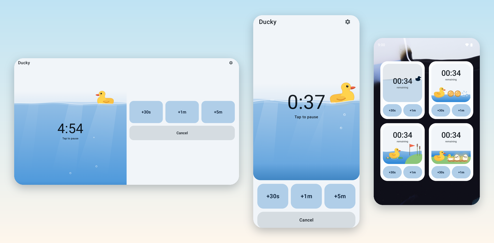
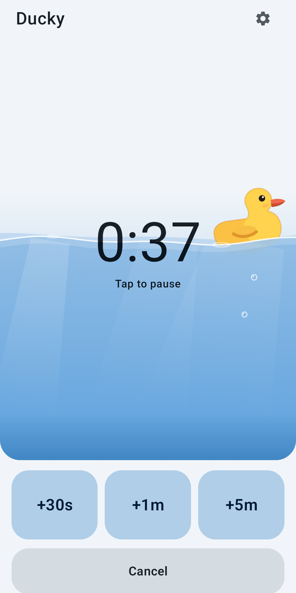
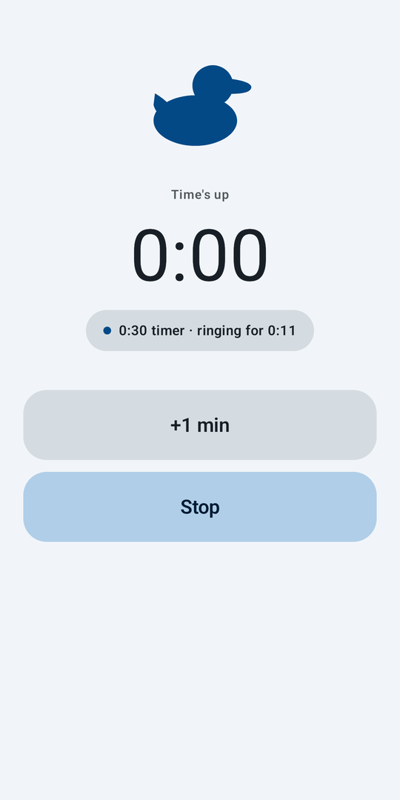
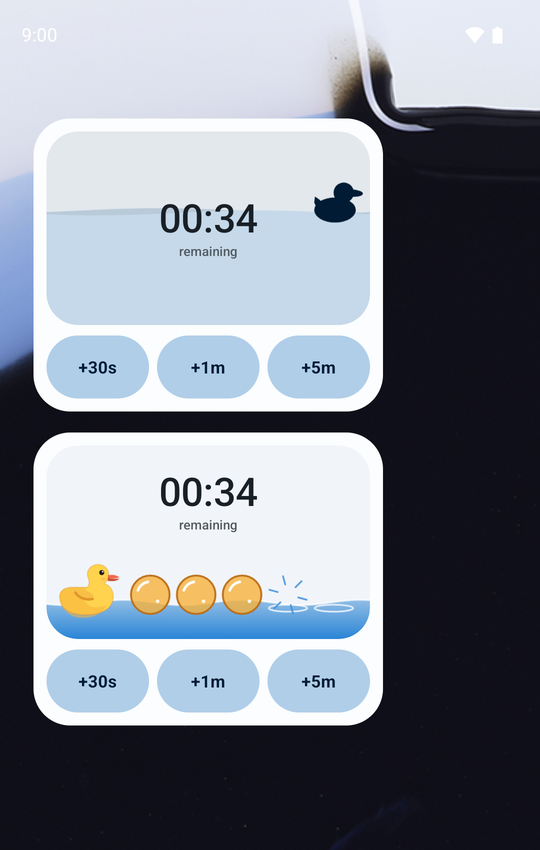
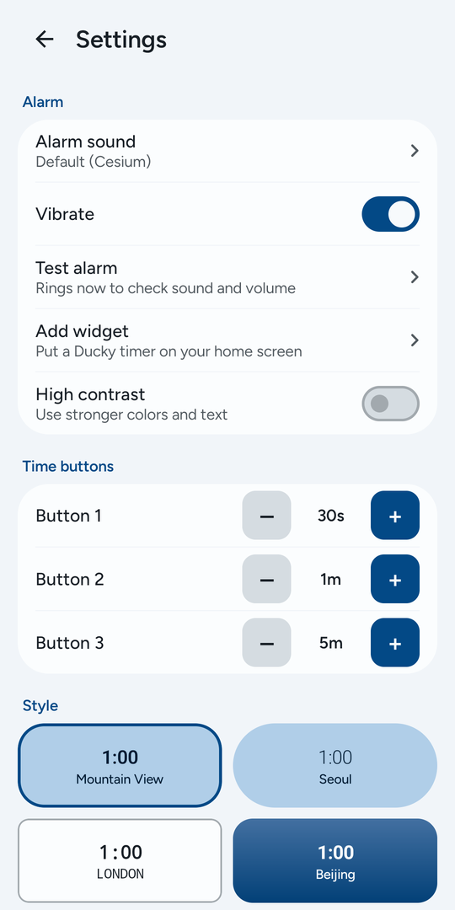
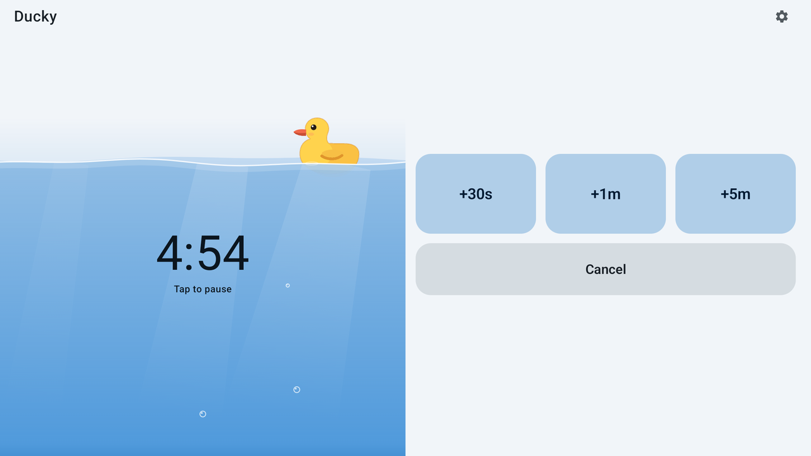

<p align="center">
  
</p>

<h1 align="center">Ducky</h1>

<p align="center"><b>The kitchen timer you can’t miss.</b></p>

<p align="center">
  A timer for Android phones, tablets and Googlebooks that you set by adding time, with a pond that drains as it counts down.
</p>

<p align="center">
  <a href="../../releases/latest"><b>Download the latest release</b></a>
  &nbsp;·&nbsp; <a href="https://merrimentlabs.com/ducky">merrimentlabs.com/ducky</a>
  &nbsp;·&nbsp; <a href="https://merrimentlabs.com/privacy/ducky">Privacy</a>
  &nbsp;·&nbsp; <a href="#install">Install</a>
</p>

<p align="center"><sub>Android 14 or newer · phones, tablets and Googlebooks · no internet permission · Apache License 2.0</sub></p>

<p align="center">
  
</p>

## What it does

Tap to add time, watch the water drain, hear the alarm. Ducky does one job, and it takes that job seriously.

- **Taps add up.** +30s, +1m and +5m start the countdown on the first tap, and every tap after that adds to it. +1m, +1m, +30s is one 2:30 timer.
- **The pond is the clock.** The water level is the time left. It drains as the timer runs, with a rubber duck riding the surface down. Pause and the duck dozes; cancel and the pond refills. Tilt the phone and the water tilts with it, and the duck glides to the low side and bumps the edge.
- **Four widgets.** Water tank drains as time runs. Lily pads has the duck hop from pad to pad toward the bank. Bubbles pops one bubble at a time, and Egg timer hatches one egg at a time, so what's left is the time left. All four add time without opening the app, and Settings, Add widget shows them side by side.
- **The alarm is hard to miss.** At zero Ducky rings on the alarm volume and vibrates until you stop it. On a locked or sleeping phone a full-screen alarm opens over the lock screen; while you're using the phone it drops down from the top of the screen. Every place that shows a ringing alarm (the alarm screen, the notification, the widgets) offers the same two choices: Stop or one more minute.
- **Yours to adjust.** Three button amounts, the alarm sound, vibration, four styles, twelve colors or any color from a wheel, and a high-contrast mode. The water and the app icon follow your color.

Ducky runs one timer at a time. It is a timer, not a clock app, so there is no stopwatch and no recurring alarm.

## A look around

<table>
  <tr>
    <td width="25%"></td>
    <td width="25%"></td>
    <td width="25%"></td>
    <td width="25%"></td>
  </tr>
  <tr>
    <td>The pond drains with the time left.</td>
    <td>The alarm, over the lock screen too.</td>
    <td>The four widgets.</td>
    <td>Settings.</td>
  </tr>
</table>

<p align="center">
  
</p>

The screenshots come from release builds on the Android emulator; [tools/](tools/README.md) has the script that turns them into these images.

## Your data

Ducky collects nothing. It requests no network permission of any kind (the build fails if a library tries to add one), and it has no accounts, ads, analytics or crash reporting. It keeps the running timer, your settings and two small screen hints (whether it has asked for notifications, and when you hid the full-screen alarm tip) in its private storage on your device. [How Ducky works](docs/ARCHITECTURE.md#what-ducky-keeps) lists every file. If device backup is on, Android itself may copy them to your Google account. The timer screen reads the motion sensor to tilt the water; the reading is used for drawing only and is never stored. The links in Settings, About open in your browser or mail app, not in Ducky. The [privacy policy](https://merrimentlabs.com/privacy/ducky) has the details.

## Install

Download `ducky-<version>.apk` from the [latest release](../../releases/latest) and open it on your device (Android 14 or newer). Installing from outside an app store means allowing your browser or file manager to install apps, and checking yourself that the file is the real one. The easy check is `scripts/release.sh --verify ducky-<version>.apk` from a clone of this repository: it needs no key, only `unzip` and `apksigner` (from the Android SDK's build-tools, found through `ANDROID_HOME` or `ANDROID_SDK_ROOT`, or on your `PATH`), and it checks the signature, compares the signing certificate with Ducky's, and prints the certificate SHA-256 in this form:

`4F:86:15:6A:55:92:2A:CD:96:98:F0:46:7D:00:09:DD:57:CD:1F:4E:9E:D1:4E:05:7D:24:86:D4:E2:6A:4D:E2`

To check by hand, run `apksigner verify --print-certs ducky-<version>.apk`. It prints the same value in lowercase without colons, on the line `Signer #1 certificate SHA-256 digest:`

`4f86156a55922acd9698f0467d0009dd57cd1f4e9ed14e057d2486d4e26a4de2`

Each release also lists the file's SHA-256 in `SHA256SUMS`. Ducky does not check for updates itself, because it never goes online. To hear about new versions, watch this repository's releases on GitHub (Watch, Custom, Releases), or add the repository to an updater such as [Obtainium](https://github.com/ImranR98/Obtainium). Settings, About, Releases opens the releases page.

## How it's built

Ducky is one Kotlin module with Jetpack Compose for the app and Glance for the widgets. There is no dependency injection and no layering beyond what a timer needs.

**The alarm decides.** The design rests on one rule: the system alarm decides when the timer rings, and the saved end time decides what every screen shows. When you add time, Ducky writes the new end time to DataStore and schedules it with `AlarmManager.setAlarmClock`, which fires on time even in Doze and survives the app being closed. The pond, the notification countdown and the widgets only read that end time; none of them can delay or move the alarm. A reboot, an app update or a change to the wall clock re-derives everything from the saved deadline. Every change goes through one controller under one lock, in a fixed order, so a crash part way through leaves the alarm consistent with what was saved.

**The pond.** It is drawn on a Compose canvas. The water level is recomputed from the deadline on every frame, and only the transitions (a rise when you add time, the refill on cancel) are animated as offsets on top, so the picture can never lag behind the real time. The duck has its own small simulation for floating, blinking and dozing, and a one-dimensional rigid body for gliding along the surface: the tilt pulls it, water drag slows it, and the pond's edges bounce it back with most of its speed taken away. It runs in fixed 1/120 s steps, so it behaves the same at any frame rate. With animations turned off in Android's settings, the pond holds still at the right level and the motion sensor is never used.

**The widgets.** Home-screen widgets can only change their picture every few seconds, so the widgets step instead of flowing: the tank's water drops a little at each step, on the lily pads the duck hops to the next pad, and in Bubbles and Egg timer one bubble pops or one egg hatches. A short timer gets fewer bubbles, eggs or lily pads (about one per 7 seconds), so each one still goes on its own step. The clock in all four is a system chronometer, so the seconds stay smooth. [docs/widgets/](docs/widgets/README.md) has the design reasoning.

**Ringing.** It is a foreground service that plays the alarm on the alarm audio stream and stays up until you choose Stop or +1 min. Each Stop and +1 min carries the ring it belongs to, so a late tap can never silence a newer alarm.

**Tests.** 420 unit tests (JUnit and Robolectric) cover the controller's state changes and ringing rules, recovery after a reboot, update or clock change, the pond's level and motion math, the duck's glide, widget layout and rendering, launcher icon aliases, the About links and the open-source license list. They cover 99.3% of lines, and CI fails the build under 95% or on any compiler or lint warning. Release builds are minified with R8 and checked on the Android emulator at phone, tablet and large-screen sizes, and the app has been used on a Pixel phone day to day through development.

[docs/ARCHITECTURE.md](docs/ARCHITECTURE.md) has the rules the code keeps, and why.

**How this is built.** I'm a product manager who builds. I decide what each app does, how it
should feel, and what it leaves out. The code is written with AI coding agents that I direct,
inside a process I designed: every change has to pass unit tests, a license audit and an
independent review before it lands, and I check the result on real devices before anything
ships. This repo starts from a clean snapshot of my private working repo, and each change after
that is carried over as its own commit. I write about how the process works at
[jessejohnston.ai](https://jessejohnston.ai).

## Build it yourself

You need JDK 21 and the Android SDK with platform 36. Point Gradle at the SDK with `ANDROID_HOME` (or `sdk.dir` in `local.properties`). Then:

```sh
./gradlew assembleDebug
./gradlew createDebugUnitTestCoverageReport lintDebug
python3 scripts/coverage.py --min 95
```

The debug APK is `app/build/outputs/apk/debug/app-debug.apk`, signed with your own debug key, so anyone can build and install it. The first test run downloads Robolectric's Android runtime, a few hundred megabytes.

Release builds refuse to build without a release key. To try a minified release build locally, pass `-PallowDebugSigning=true` (debug-signed, not for distribution). `scripts/release.sh <tag>` builds a signed release APK from a clean checkout of a tag, with a key you supply through `DUCKY_KEYSTORE_PATH`, `DUCKY_KEYSTORE_KEYALIAS` and `DUCKY_KEYSTORE_PASS` (or a password prompt). It checks that R8 kept the widget classes apart and that the APK carries the expected certificate (set `DUCKY_EXPECTED_CERT` to yours), then writes the APK and `SHA256SUMS` to `dist/`. It also checks that the APK records the tag's commit, and keeps R8's mapping file beside the APK as `ducky-<version>-mapping.txt`: a crash stack trace from a release install can only be read with the mapping from that exact build (`retrace` from the SDK's command-line tools), so keep it with your copy of the release, and never publish it. Published releases are built this way from a checkout of the public tag, so the commit recorded inside each APK is one you can check out. A wrong password or key alias stops the script before it builds anything, and `scripts/release.sh --verify <apk>` checks the signature and signing certificate of an APK it did not build, such as a download from the releases page, and shows the commit it records. [docs/RELEASING.md](docs/RELEASING.md) has the full release checklist, including signing a build with your own key.

The launcher icons and the README images are generated by the scripts in [tools/](tools/README.md).

## Roadmap

Next:

- A short clip of the pond and the widgets in motion for this page.
- Library and toolchain upgrades (Android Gradle Plugin 9, Kotlin 2.4, newer Compose and Glance), each as its own tested change.

Not planned:

- More than one timer at a time, a stopwatch, or recurring alarms. Ducky is a timer, not a clock app.
- Anything that needs the internet: accounts, sync, or an update check inside the app. Ducky requests no network permission, and that is the point.

## Contributing

Issues are welcome: bugs, alarms that didn't ring, and ideas. Ducky is maintained by one person, so there is no support promise. Pull requests are read; a change that fits is applied in the private working repository and carried back here as its own commit, credited to you. [CONTRIBUTING.md](CONTRIBUTING.md) has the details, and [SECURITY.md](SECURITY.md) says how to report a security problem privately.

## License

Ducky is licensed under the [Apache License 2.0](LICENSE). If you redistribute it or build on it, keep the [NOTICE](NOTICE) file with your copy; it reads:

```
Ducky
Copyright 2026 Jesse Johnston
Published by Merriment Labs (https://merrimentlabs.com)
```

The license gives no permission to use the Ducky or Merriment Labs names (section 6). In the app, Settings, About, Open-source notices shows the same notice and license text in Ducky's own row.

Ducky is built with open-source libraries (AndroidX, Jetpack Compose, Glance, DataStore, Kotlin coroutines and their dependencies), under the Apache License 2.0 and, for two protobuf runtimes, the BSD 3-Clause license, and uses Material Symbols and Material Icons (Apache License 2.0) in Settings and the notification. The build fails if a dependency arrives under any other license. The full list, with every license text, is in the app under Settings, About, Open-source notices. The duck on the pond is the Merriment Labs duck from merrimentlabs.com.

## About

> Ducky is made by [Merriment Labs](https://merrimentlabs.com), a one-person Android
> studio run by Jesse Johnston. Questions, bugs and ideas are welcome at
> [merrimentlabs.com/contact](https://merrimentlabs.com/contact) or
> hello@merrimentlabs.com.
>
> Copyright 2026 Jesse Johnston. Published by Merriment Labs.
