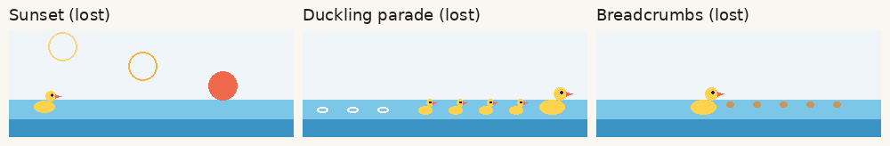
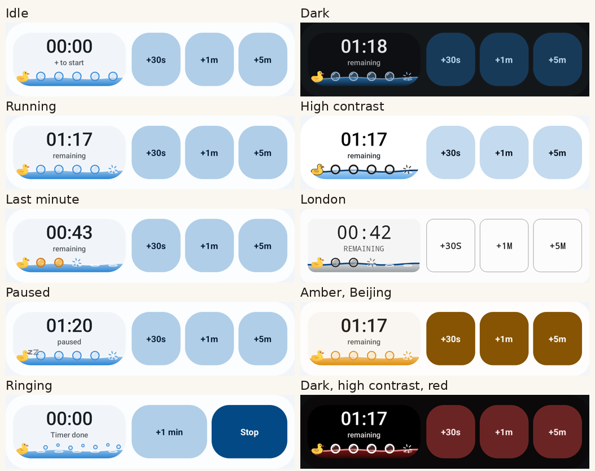
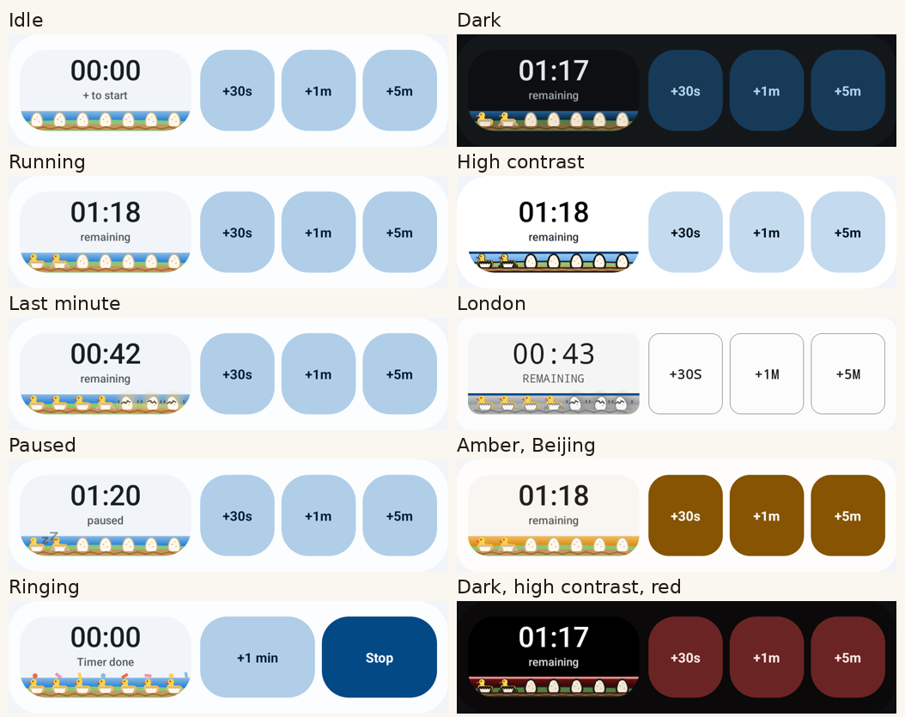
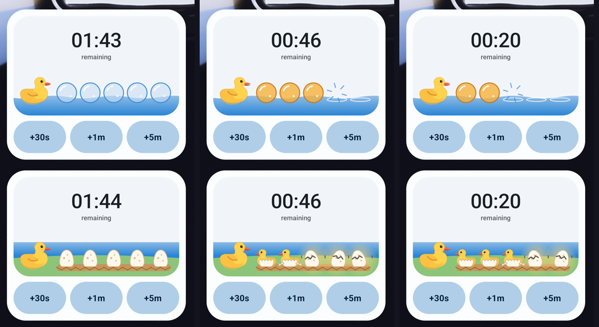

# Widget looks: Bubbles and Egg timer

Ducky has four home-screen widgets. They share everything but the picture in the time box:
the layouts, the add-time buttons, the ringing row (+1 min and Stop), the system Chronometer
clock and the display tick. This note explains why two of the looks are Bubbles and Egg timer.

## The constraint

A widget's picture can change only when the app pushes a new one, and the display tick that
pushes it runs on AlarmManager, which will not fire sooner than 5 seconds apart (on a Pixel phone
and on the emulator: `min_futurity=+5s`). For long timers the tick is slower still: total / 90,
at most 15 s. Anything that looks like continuous motion therefore stutters. Lily pads works
because a hop is a discrete event: the picture is supposed to jump.

So every candidate had to pass these tests:

1. **Every frame is a complete, meaningful state**, and the picture changes only when that
   state does (never between events).
2. **The real-world thing does not move continuously.** A coarse step of something that
   normally glides still reads as stutter.
3. **Countable at a glance in the thinnest strip** (the 2x1 widget gives the picture a band
   about 14 to 22 dp tall), and from across a kitchen in the larger sizes.
4. **Not a repeat of Lily pads' mechanic** (a character traveling along a row).
5. Works with the shared rules: the picture lives in the band at the bottom of the time box
   and the clock sits above it on the sky, so text contrast is the same as Lily pads'
   (checked across all accents in `PondColorsTest`); ringing in the 2x1 shows only the two
   buttons; twelve accents, high contrast, London, dark mode.

## Five concepts

| Concept | How it moves | Verdict |
|---|---|---|
| **Bubbles** | A row of soap bubbles beside the floating duck. One pops per slice of the timer, from the far end toward the duck. The bubbles left are the time left. | **Picked.** A pop is instant by nature. Reads like a battery bar. |
| **Egg timer** | A nest of eggs beside the duck. One hatches into a duckling per slice, from the duck's side outward. Eggs left are time left; the yellow row is time gone. | **Picked.** A hatch is an event, the name is a kitchen pun, and the mechanic (transform in place) is different from both Lily pads (travel) and Bubbles (vanish). |
| Sunset | The sun (the sun gradient from merrimentlabs.com) sinks toward the pond in steps. | Lost on test 2: everyone knows the sun glides, so a stepped sun is the same stutter the water tank had. |
| Duckling parade | Ducklings swim out of the reeds and join the mother one at a time. | Lost on test 4 (it is travel again) and test 3 (a moving line of small ducks is hard to count in the strip). |
| Breadcrumbs | The duck eats one crumb per slice, moving along the row. | Lost on tests 4 and 3: the same travel as Lily pads, and crumbs are a few pixels in the strip. |

## How the picked two behave

Both split the remaining time into equal slices, one per item (3 to 8 items, by width). An item
goes at the end of its slice, so the last one goes when the timer rings. The frame logic is
`StepFrame` (pure, tested); a widget redraws its picture only when the frame changes.

**Short timers get fewer items.** Two renders can land up to about 5.8 s apart (the 5 s
tick floor plus up to 0.8 s of delivery delay seen on a Pixel phone), so a slice shorter than that lets
two items go in one render: with equal slices, a 30 s timer on a widget with 8 items would have
3.75 s slices and go 8, 7, 6, 4, 3, 2 and then two at the ring (reproduced on the emulator with
the frame trace). So `StepFrame.itemsFor` gives a timer at most one item per 7 s: 30 s shows 4, 45 s shows 6, a
minute or more the full row, under 14 s one. With no timer (idle, Test alarm) the row is full. The
picture re-lays out when the total changes (start, +time). `StepFrameTest` runs every render of 13
durations at every width with on-time, late and alternating ticks. Lily pads has the same limit
(see Checks below).

**Tracing a run.** `adb shell setprop log.tag.DuckyFrames DEBUG` turns on one log line per widget
composition (look, box size, mode, remaining, total, and the item, pad or level shown), in any
build including R8. `adb logcat -s DuckyFrames` reads it. SizeMode.Exact composes one picture per
size the launcher reports (portrait and landscape), so each widget logs two boxes.

| State | Bubbles | Egg timer |
|---|---|---|
| Idle | Full row, the duck looks at you | Full nest, the duck looks at you |
| Running | Bubbles pop one by one; the last pop leaves a small burst, popped spots leave a ring on the water | Eggs hatch one by one; the newest duckling cheeps beside its shell pieces |
| Last minute (60 s or less, running) | The bubbles left turn marigold and the duck perks up | The eggs left glow (the sun color from merrimentlabs.com), tilt and show a crack |
| Paused | The duck naps (Zs), nothing pops | The duck and ducklings nap |
| Ringing | Every bubble gone, small bubbles rise, the duck cheers | Every egg hatched, confetti, the duck cheers |

The last-minute cue is 60 s wide on purpose: a long timer's tick is 15 s, so the cue still gets
about four renders. It can appear up to one tick late (seen on the emulator: the bubbles turned
golden at 0:53 on a 2-minute timer).

On the emulator home screen during a 2-minute timer (1:43, 0:46 and 0:20 left), both widgets
at the Pixel Launcher's 3x2 size:

## Checks

- **Geometry:** the band is Lily pads' band (`LilyHop.bandDp`), so the clock keeps at least 30 dp.
  `CountedScenesTest` checks that bubbles, eggs, ducklings and the duck stay inside the band at
  every widget size, renders every state at sizes from 0.1 dp to 900 dp, and every accent x theme
  x contrast x style.
- **Small sizes:** in the 2x1 strip the duck and three or more items stay countable; the egg
  details (speckles, cracks) are lost there, the count is not. In the 2x1 ringing state the
  picture is hidden, as in the other widgets.
- **TalkBack:** the picture is decorative; the time box speaks the shared state text. While
  running it is approximate ("Timer, about 2 minutes left", "under a minute left"), because it is
  read up to one tick after it was written; paused it is exact. The Chronometer inside carries its
  own live description. The picker labels are "Bubbles" and "Egg timer".
- **Reduced motion:** nothing animates. A picture changes at most once per tick.
- **Water tank and Lily pads unchanged by the new looks:** captures of both in every state (idle,
  paused and ringing; default, London and high contrast; light and dark) were pixel-identical
  before and after Bubbles and Egg timer were added.
- **Short timers (all three counted looks):** at most one item or pad per 7 s
  (`StepFrame.itemsFor`, `LilyHop.padCountFor`), because two renders can be 5.8 s apart. A 30 s
  timer gets 4 pads; 56 s or longer gets every pad that fits, so longer timers draw as before.
  An emulator trace of a 30 s timer: Lily pads 0, 1, 2, 3, shore in both boxes; Bubbles and
  Egg timer 4, 3, 2, 1, 0.
